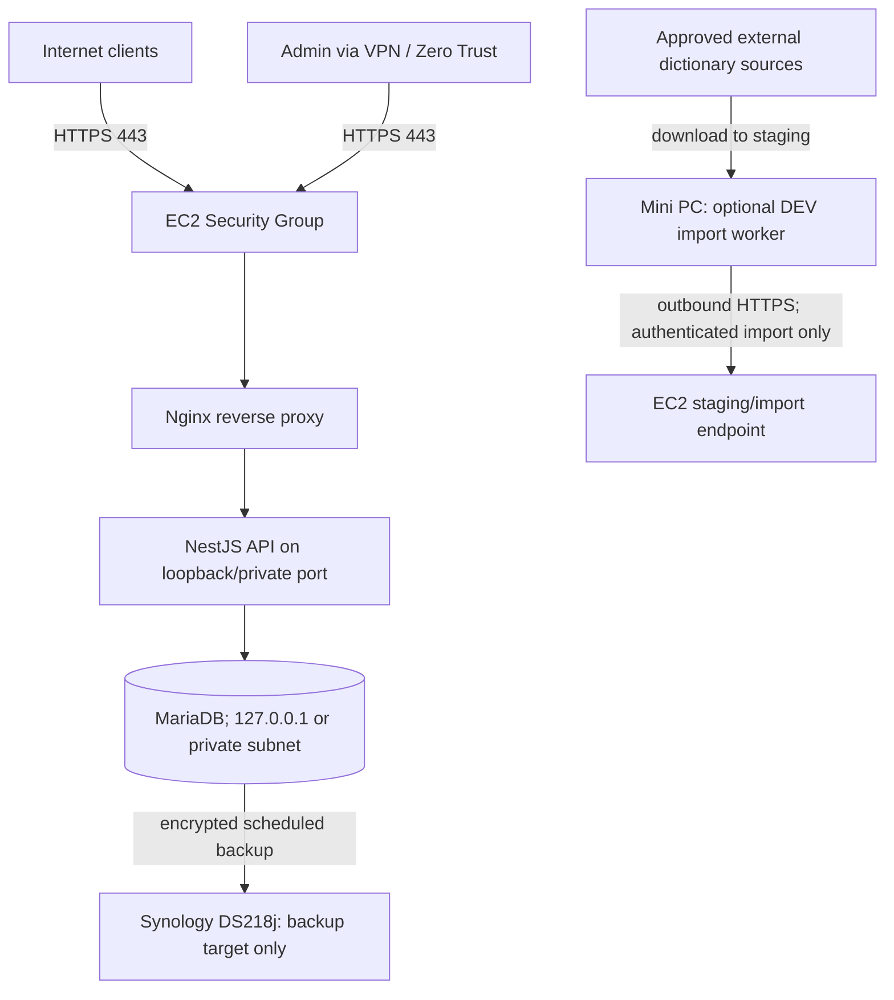

# NAS / Mini PC / EC2 인프라 역할 및 조사 절차

> 최신화 기준: 2026-11-14 · develop `a38e885`
> 호스트 상태를 실제로 조회하지 않았습니다. 장비의 여유 자원, OS, 네트워크 및 서비스는 모두 **UNVERIFIED**입니다.

## 1. 권장 배치 초안



Mini PC와 NAS는 Live API의 필수 runtime dependency가 되지 않도록 합니다. NAS에 DB primary나 공개 API를 올리지 않고, Mini PC Worker가 PROD DB port로 직접 접속하지 않게 합니다. 실제 사양이 부족하거나 availability가 검증되지 않으면 Mini PC는 DEV-only/연구용으로 한정하고, PROD import도 EC2 내부 승인 job 또는 관리형 compute로 이동합니다.

| 장비 | 제안 역할 | 수행하지 않을 역할 |
|---|---|---|
| 개발 Mac/PC | LOCAL API, 로컬 DB, unit/E2E | 운영 DB 직접 접속, PROD secret 보관 |
| HP t620 Ubuntu | 검증 후 DEV API 또는 제한된 DEV import worker | PROD DB 직접 접근, Live SLA가 필요한 서비스 |
| Synology DS218j DSM 7.3 | 암호화된 dump 및 raw source archive 보관, 제한된 내부 backup target | 인터넷 노출 API, 운영 MariaDB, Container/Docker 실행을 지원한다고 가정 |
| AWS EC2 Amazon Linux 2023 | PROD Nginx/API 및 (현재 목표로는) MariaDB | MariaDB 3306 인터넷 공개, 외부 Worker 직접 DB 접근 |

## 2. 확인되어야 할 값

| 구간 | 조사 대상 |
|---|---|
| HP t620 | CPU 모델/코어, RAM 총량/여유, disk 종류/여유/SMART, Ubuntu 버전, 가동률·온도·전원, SSH 접근 제어, ISP/NAT/DNS, 수신 포트 |
| Synology | 모델/DSM build, volume 총량·여유·SMART/RAID, 공유폴더 ACL, snapshot/Hyper Backup/외부 복사 여부, SMB/NFS/SSH 노출, 계정/MFA, 복원 리허설 |
| EC2 | instance type/region/AZ, OS release, CPU/RAM/disk/IOPS, Security Group, EIP/DNS, Nginx site config, API process manager, MariaDB version/listen/TLS/privilege, CloudWatch/로그, backup/restore |
| 네트워크 | 실제 Admin 경로, VPN/Zero Trust, ISP 공인 IP, DNS, TLS 발급·갱신, outbound 제한, 장애 시 접근 경로 |

## 3. Read-only 점검 명령 후보

운영자 승인 후 해당 장비에서 로컬로 실행하고, 결과 중 IP·계정·경로·도메인·환경값은 공유 전에 가립니다. 이 문서 작성 시에는 실행하지 않았습니다.

### Ubuntu Mini PC

```bash
hostnamectl
uname -a
lsb_release -a
lscpu
free -h
df -hT
lsblk -o NAME,SIZE,TYPE,FSTYPE,MOUNTPOINTS
uptime
systemctl --type=service --state=running
ss -lntup
```

### EC2 Amazon Linux 2023

```bash
cat /etc/os-release
uname -a
nproc
free -h
df -hT
lsblk
uptime
systemctl --type=service --state=running
ss -lntup
nginx -v
pm2 status
mariadb --version
```

`nginx -T`, process command line, systemd unit dump, `ps e`, env file, DB grants/dump는 비밀정보를 포함할 수 있습니다. 필요한 경우 운영자 측에서 민감값을 제거해 별도로 검토하며, 이 명령 목록은 해당 출력을 요청하지 않습니다.

### Synology DSM

DSM UI에서 Storage Manager, Resource Monitor, Task Scheduler, Hyper Backup, Security/Firewall, Control Panel의 SSH 상태를 읽기 전용으로 확인합니다. 모델별 package/container 지원 여부는 DSM UI 및 Synology 공식 호환성 정보를 기준으로 확인하고, Docker/Container Manager가 있다고 가정하지 않습니다.

## 4. Nginx와 포트 정책

- 외부 진입점은 80(HTTPS redirect)과 443만 허용하고, SSH는 지정된 관리자 경로로 제한합니다.
- Nginx는 TLS 종료 및 `/api/v1` reverse proxy를 수행합니다. API는 loopback 또는 private interface에서 수신합니다.
- MariaDB는 EC2 내 localhost 또는 private subnet에서만 접근하며 inbound public rule을 만들지 않습니다.
- Admin route는 VPN/Zero Trust source network allow-list를 추가합니다. JWT/RBAC만으로 무차별 인터넷 노출을 정당화하지 않습니다.
- 기존 Nginx 설정/사이트/포트는 현장 조사 전 수정하지 않습니다. 신규 server block은 실제 기존 listen/domain과 충돌이 없는 것을 확인하고 배포합니다.

## 5. 외부 데이터 pipeline

- 다운로드는 허용된 source endpoint에서 Worker의 격리 staging으로만 받습니다.
- 원본 파일은 checksum, source/version, 수집시각, license, attribution 텍스트를 함께 기록하고, 검수 후에만 DB에 import합니다.
- DEV Worker는 PROD credentials를 받지 않습니다. PROD import는 인증된 Admin import endpoint 또는 EC2 내부 승인 job을 통합니다.
- Worker 장애/네트워크 단절 시 이미 게시된 Live 데이터는 계속 읽힙니다. import는 checkpoint 및 idempotency key로 재시도합니다.
- 대용량 원본은 NAS 공간/전송속도/복구 가능성을 확인한 뒤 archive할지 결정합니다. NAS 단일 사본을 백업으로 간주하지 않습니다.

