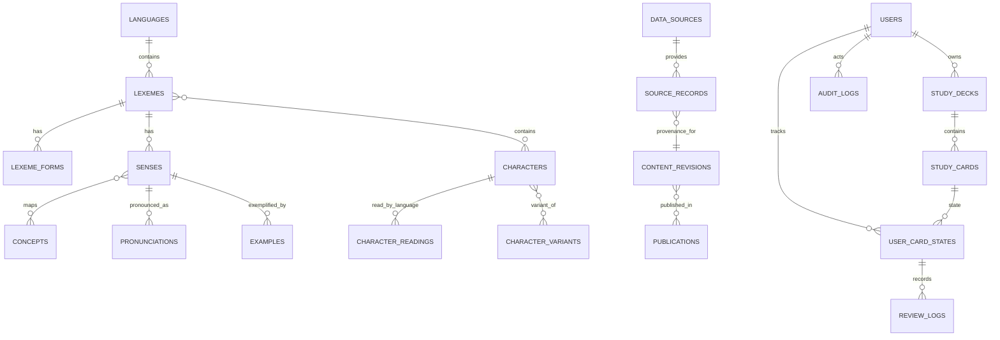

# 다국어 사전·학습 MariaDB 데이터 모델 초안

> 최신화 기준: 2026-11-14 · develop `a38e885`
> **목표 모델 제안**이며 현재 저장소의 Entity/Schema가 아닙니다. 실제 Migration 작성 전 요구사항·데이터 샘플·라이선스를 검증해야 합니다.

## 1. 모델링 원칙

- `Lexeme`(한 언어의 어휘)와 `Concept`(언어 독립 개념)를 분리합니다. 다의어는 Lexeme당 여러 Sense, 동의어/번역은 여러 Lexeme의 Sense가 동일 Concept에 연결되는 방식으로 표현합니다.
- 표기·활용형(`lexeme_forms`), 발음(`pronunciations`), 한자(`characters`), 언어/지역별 독음(`character_readings`), 호환/이형 표기(`character_variants`)를 한 컬럼에 합치지 않습니다.
- Chinese `zh-Hans` / `zh-Hant`는 language/script/region metadata로 분리하고, 동일 entry 여부를 임의로 단정하지 않습니다.
- 출처·license·version·attribution·import batch는 개별 entry와 연결해 출처가 섞인 필드도 추적할 수 있게 합니다.
- 미승인 변경은 Live read model에 노출하지 않습니다. 게시 콘텐츠 및 study card는 immutable revision을 참조합니다.
- 문자열 컬럼은 `utf8mb4`를 사용합니다. Unicode normalization key와 사용자에게 보이는 원문을 분리하고, case/accent/collation 의존 동등성은 언어별 테스트로 검증합니다.

## 2. ERD



`SENSES ↔ CONCEPTS`는 `sense_concepts` junction으로, character variants는 direction/type을 가진 `character_variants`로 구현합니다. `CONTENT_REVISIONS`/`PUBLICATIONS`는 공개 시점의 버전을 고정합니다. 각 편집 엔터티를 revision row로 저장할지 typed snapshot table로 저장할지는 샘플 조회·검색량에 따라 schema review에서 확정합니다.

## 3. 테이블 후보와 주요 컬럼

| 테이블 | 역할 및 컬럼 후보 (PK는 `id` 또는 자연키, 시간은 UTC) |
|---|---|
| `languages` | 언어/스크립트: `id`, `bcp47_tag` UNIQUE, `name_native`, `name_en`, `script`, `is_active` |
| `lexemes` | 언어별 어휘 단위: `id`, `language_id` FK, `lemma`, `normalized_lemma`, `part_of_speech`, `homograph_no`, `status`, `current_revision_id` |
| `lexeme_forms` | 표기/변형: `id`, `lexeme_id` FK, `form_text`, `normalized_form`, `script`, `form_type`, `is_primary` |
| `senses` | 어휘별 뜻: `id`, `lexeme_id` FK, `sense_no`, `definition`, `register`, `domain`, `status`, `current_revision_id` |
| `concepts` | 언어 독립 의미 concept: `id`, `concept_key` UNIQUE, `description`, `status`, `current_revision_id` |
| `sense_concepts` | 의미 연결: `(sense_id, concept_id)` unique, `relation_type`, `confidence`(nullable), `review_status` |
| `translations` | 선택적 directional mapping/번역 표현: `id`, `source_sense_id`, `target_sense_id`, `relation_type`, `context_note`; 동일 Concept 관계와 별도 정보가 필요한 경우만 사용 |
| `pronunciations` | 어휘 Sense/표기의 발음: `id`, `lexeme_id`, `sense_id` nullable, `language_id`, `reading`, `system`, `audio_source_id` nullable |
| `characters` | Unicode scalar/문자: `id`, `codepoint` UNIQUE, `character`, `radical`, `stroke_count`, `unicode_version` |
| `character_readings` | 문자별 언어 읽기: `id`, `character_id`, `language_id`, `reading`, `reading_type`, `romanization`, `source_record_id` |
| `character_variants` | 이체/간·번체·compatibility 관계: `(character_id, variant_character_id, variant_type)` UNIQUE |
| `lexeme_characters` | 어휘 표기 내 문자와 위치: `(lexeme_form_id, character_id, position)`; 문자 분석이 필요한 경우 |
| `examples` | 예문: `id`, `sense_id`, `language_id`, `text`, `source_record_id`, `license_scope` |
| `example_translations` | 예문 번역: `id`, `example_id`, `target_language_id`, `text`, `source_record_id` |
| `data_sources` | 출처 등록: `id`, `name`, `source_url`, `license_id`, `attribution_text`, `commercial_use`, `redistribution_terms`, `checked_at`, `version_policy` |
| `source_records` | 원본 레코드 provenance: `id`, `data_source_id`, `external_id`, `source_version`, `checksum`, `import_job_id`, `raw_payload_uri`, `retrieved_at` |
| `import_jobs` | 작업 단위: `id`, `source_id`, `status`, `idempotency_key` UNIQUE, `checkpoint`, counts, `started_at`, `finished_at`, `error_summary` |
| `import_staging_entries` | 검수 전 원본/normalized row: `id`, `import_job_id`, `external_id`, `payload`, `validation_status`, `matched_entity_id`, `review_status` |
| `content_revisions` | immutable content revision: `id`, `entity_type`, `entity_id`, `version`, `payload_hash`, `created_by`, `created_at`; `(entity_type, entity_id, version)` UNIQUE |
| `publications` | 게시 스냅샷: `id`, `version`, `status`, `manifest_hash`, `approved_by`, `published_by`, `published_at` |
| `publication_revisions` | 게시물에 포함된 revision: `(publication_id, content_revision_id)` UNIQUE |
| `users`, `roles`, `user_roles` | 현재 사용자 모델과의 통합 여부를 결정한 뒤 채택. 최소 MVP는 기존 users 및 admin role 재사용 가능 |
| `study_decks` | 사용자/공유 덱: `id`, `owner_user_id`, `name`, `visibility`, timestamps |
| `study_cards` | 반복 가능한 카드: `id`, `deck_id`, `prompt_revision_id`, `answer_revision_id`, `card_type`, `created_at` |
| `user_card_states` | 사용자별 복습 상태: `id`, `user_id`, `study_card_id`, `due_at`, `interval`, `ease`, `status`, `last_reviewed_at`; `(user_id, study_card_id)` UNIQUE |
| `review_logs` | 불변 답변/복습 이벤트: `id`, `user_id`, `study_card_id`, `content_revision_id`, `result`, `response_ms`, `reviewed_at` |
| `audit_logs` | 운영 변경: `id`, `actor_user_id`, `action`, `entity_type/id`, `revision_id`, `request_id`, `reason`, `created_at` |

### 역할·컬럼 요약

- **Source/provenance:** `data_sources → source_records → import_jobs/staging → approved revision` 순서로 입력 추적. `raw_payload_uri`는 접근 통제된 object/file storage를 가리키고 원본 데이터/키를 일반 로그에 넣지 않습니다.
- **Publication:** `publication_revisions`의 완전한 집합이 immutable publish snapshot입니다. Live는 한 번 읽은 publication ID로 요청 전체를 처리해 revision 혼합을 방지합니다.
- **Study stability:** `study_cards` 및 `review_logs`는 실제 노출된 content revision ID를 보유합니다. 편집이 과거 정답과 점수에 영향을 주지 않습니다.
- **Deletion:** 사용자 삭제/개인 데이터 삭제, source takedown, 사전 엔터티 병합/분리 정책을 별도 정의합니다. 공유 source row를 무조건 cascade 삭제하지 않습니다.

## 4. 타입·키·제약 초안

아래는 Migration 설계 시작점입니다. MariaDB 실제 버전과 TypeORM driver의 constraint 지원을 확인하고, CI에서 해당 버전으로 검증한 뒤 확정합니다.

| 영역 | 권장 DB 표현 |
|---|---|
| dictionary entity ID | `BIGINT UNSIGNED AUTO_INCREMENT PRIMARY KEY`; 각 FK도 동일한 타입/부호 |
| 기존 사용자 FK | 현 `users.id`는 Entity상 기본 `int`로 선언되어 있습니다. `SHOW CREATE TABLE users`로 signedness를 확인한 뒤 정확히 같은 타입으로 `study_*`/`audit_logs.actor_user_id` FK 정의 |
| locale | `languages.bcp47_tag VARCHAR(35) NOT NULL UNIQUE`; language/script/region 별도 컬럼 |
| Unicode codepoint | `characters.codepoint INT UNSIGNED NOT NULL UNIQUE`; `character VARCHAR(8)` 원문, variation sequence 보조 테이블 검토 |
| 사용자 입력/lemma/form | `VARCHAR(255)` 원문 + 검색 key `VARCHAR(512)`; 대상 문자열 길이와 grapheme/normalization 테스트 후 상한 확정 |
| 정의/예문/설명 | 길이 제한을 정한 `TEXT`; 긴 원문 출처 자료는 외부 storage |
| 유형/status/tag | `VARCHAR(32..64)` + application validation. `ENUM` 사용은 상태 추가 Migration 비용 검토 후 결정 |
| source payload/revision | `LONGTEXT` + `JSON_VALID` 검증 또는 MariaDB JSON alias; 크기 제한. checksum은 `CHAR(64)` |
| 날짜·시각 | `DATETIME(3)` UTC convention; 날짜만 필요한 `playDate`류는 `DATE` |
| boolean/count | `TINYINT(1)` 또는 unsigned integer. positivity/range check는 app + DB constraint |

### 테이블별 주요 PK/FK/UNIQUE 후보

| 테이블 | PK | FK | UNIQUE/인덱스 후보 |
|---|---|---|---|
| `languages` | `id BIGINT UNSIGNED` | — | `uq_languages_bcp47_tag(bcp47_tag)` |
| `lexemes` | `id BIGINT UNSIGNED` | `language_id → languages.id` | `(language_id, normalized_lemma, homograph_no)`; `(language_id, status, id)` |
| `lexeme_forms` | `id BIGINT UNSIGNED` | `lexeme_id → lexemes.id` | `(lexeme_id, normalized_form, form_type)`; `(normalized_form, script)` |
| `senses` | `id BIGINT UNSIGNED` | `lexeme_id → lexemes.id` | `(lexeme_id, sense_no)` |
| `concepts` | `id BIGINT UNSIGNED` | — | `concept_key` |
| `sense_concepts` | composite `(sense_id, concept_id, relation_type)` | sense/concept FKs | reverse lookup `(concept_id, sense_id)` |
| `translations` | `id BIGINT UNSIGNED` | source/target sense FKs | `(source_sense_id, target_sense_id, relation_type)` |
| `pronunciations` | `id BIGINT UNSIGNED` | lexeme/sense/language FKs | `(lexeme_id, language_id, system, reading)` |
| `characters` | `id BIGINT UNSIGNED` | — | `codepoint` |
| `character_readings` | `id BIGINT UNSIGNED` | character/language/source-record FKs | `(character_id, language_id, reading, reading_type)` |
| `character_variants` | composite `(character_id, variant_character_id, variant_type)` | both character IDs → `characters.id` | reverse `(variant_character_id, character_id)` |
| `lexeme_characters` | composite `(lexeme_form_id, position)` | form/character FKs | `(character_id, lexeme_form_id)` |
| `examples` | `id BIGINT UNSIGNED` | sense/language/source-record FKs | `(sense_id, language_id)` |
| `example_translations` | `id BIGINT UNSIGNED` | example/language/source-record FKs | `(example_id, target_language_id)` |
| `data_sources` | `id BIGINT UNSIGNED` | — | `name` (여러 license/version은 별도 relation 가능) |
| `source_records` | `id BIGINT UNSIGNED` | data-source/import-job FKs | `(data_source_id, source_version, external_id)` |
| `import_jobs` | `id BIGINT UNSIGNED` | `source_id → data_sources.id` | `idempotency_key`; `(source_id, status, started_at)` |
| `import_staging_entries` | `id BIGINT UNSIGNED` | `import_job_id → import_jobs.id` | `(import_job_id, external_id)` |
| `content_revisions` | `id BIGINT UNSIGNED` | creator user FK (optional) | `(entity_type, entity_id, version)`; `payload_hash` lookup |
| `publications` | `id BIGINT UNSIGNED` | approver/publisher user FKs | `(version)`; `status,published_at` |
| `publication_revisions` | composite `(publication_id, content_revision_id)` | both IDs → parent rows | same pair key |
| `study_decks` | `id BIGINT UNSIGNED` | `owner_user_id → users.id` | `(owner_user_id, name)` if product policy requires |
| `study_cards` | `id BIGINT UNSIGNED` | deck/revision FKs | `(deck_id, prompt_revision_id, answer_revision_id)` |
| `user_card_states` | `id BIGINT UNSIGNED` | user/card FKs | `(user_id, study_card_id)`; `(user_id, due_at, status)` |
| `review_logs` | `id BIGINT UNSIGNED` | user/card/revision FKs | `(user_id, reviewed_at)`; append-only |
| `audit_logs` | `id BIGINT UNSIGNED` | actor user FK nullable | `(entity_type, entity_id, created_at)`; `(actor_user_id, created_at)` |

FK delete action은 기본 `RESTRICT`; `import_staging_entries → import_jobs` 등 폐기 가능한 임시행만 retention workflow 후 cascade를 고려합니다. Study history, publication, revision, audit를 content 삭제와 함께 cascade 하지 않습니다.

### 샘플 데이터

| 테이블 | 예시 (구조 예시이며 사전 뜻 데이터가 아님) |
|---|---|
| `languages` | `{ bcp47_tag: "zh-Hans", name_native: "简体中文", script: "Hans" }` |
| `lexemes` | `{ language_id: <zh-Hans>, lemma: "<sample>", normalized_lemma: "<NFC>", homograph_no: 1 }` |
| `concepts` | `{ concept_key: "concept:<opaque>", description: null }` |
| `sense_concepts` | `{ sense_id: <sense>, concept_id: <concept>, relation_type: "equivalent", review_status: "approved" }` |
| `source_records` | `{ data_source_id: <source>, external_id: "<source-id>", source_version: "<release>", checksum: "<sha256>" }` |
| `publications` | `{ version: 1, status: "published", manifest_hash: "<sha256>", published_at: "<UTC>" }` |
| `user_card_states` | `{ user_id: <existing-user-id>, study_card_id: <card>, due_at: "<UTC>", status: "active" }` |

## 5. 인덱스·검색 초안

- FK는 `RESTRICT`를 기본으로 하여 승인·게시·학습 이력을 실수로 지우지 않게 합니다. 단, 개인 study data의 삭제는 별도 정책에 따른 cascade/익명화를 검토합니다.
- Unique: `languages.bcp47_tag`, source별 `external_id`, job `idempotency_key`, revision `(entity_type,entity_id,version)`, publication membership, `(user_id,study_card_id)`.
- 검색 후보: `(language_id, normalized_lemma, status)`; form 검색용 `(normalized_form, lexeme_id)`; concept lookup용 `sense_concepts(concept_id,sense_id)`; character `codepoint`; review `(user_id,due_at)`.
- FULLTEXT/LIKE/별도 search index 선택은 MariaDB 버전·collation·한국어/중국어/일본어 tokenize 품질을 실제 data fixture로 벤치마크한 뒤 결정합니다. MariaDB FULLTEXT가 모든 CJK 검색을 해결한다고 가정하지 않습니다.
- offset pagination은 작은 Admin 결과에 한정하고, Live 검색은 안정 정렬 key와 cursor 기반 pagination을 우선 검토합니다.

## 6. 문자셋·정규화·시간

- 모든 다국어 텍스트 저장소는 `utf8mb4`; 신규 DDL은 explicit charset/collation을 지정하고 서버 기본값에 의존하지 않습니다.
- 원본 문자열, 검색 normalized key(NFC 등), 언어별 검색 토큰을 별도 저장합니다. NFKC로 원문을 덮어쓰지 않습니다.
- 한자 표기 구분은 code point와 script/locale provenance를 함께 보관합니다. Unicode compatibility/variation selector 처리는 테스트 예제로 고정합니다.
- 시간은 UTC `datetime(3)` 또는 요구 정밀도를 정한 뒤 일관 적용하고 API에는 ISO 8601 offset 포함 값으로 반환합니다.

## 7. 샘플 관계

```text
ko: "사과" lexeme → sense(과일) ─┐
en: "apple" lexeme → sense(과일) ├─ concept(과일)
ja: "林檎" lexeme → sense(과일) ┘
zh-Hans: "苹果" lexeme form
zh-Hant: "蘋果" lexeme form

Character "生" → ja readings (せい, しょう, ...)
              → zh-Hans reading (shēng)
              → ko reading (생)
```

위는 구조 설명용 샘플이며 고정된 dictionary fact, 최종 locale taxonomy, 초기 seed 데이터가 아닙니다.

## 8. Migration 및 검증

1. 현 Entity/Migration을 수정하지 않고 additive Migration을 설계합니다. 실제 production schema와 `SHOW CREATE TABLE` 비교 전 Migration을 실행하지 않습니다.
2. 빈 MariaDB에서 전체 schema build, FK/unique rollback, 반복 Migration을 CI에서 검사합니다.
3. Unicode fixture에 한글 조합형/완성형, 간체·번체, 일본어 kana/kanji, variation selector, 보조 평면 문자를 둡니다.
4. staging import는 기존 publication을 변경하지 않는지, 같은 idempotency key 재실행이 중복 생성하지 않는지 테스트합니다.
5. 사용자 답변 이력은 revision ID를 계속 가리키는지, publication 교체 후 기존 study session 결과가 변경되지 않는지 테스트합니다.
6. 인덱스/검색 성능은 실제 sample scale을 정의한 뒤 EXPLAIN 및 부하 테스트로 확인합니다. 현재 데이터량/응답시간은 **UNVERIFIED**입니다.

