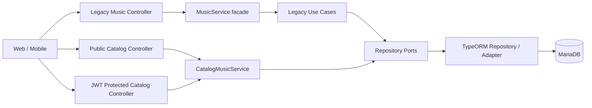
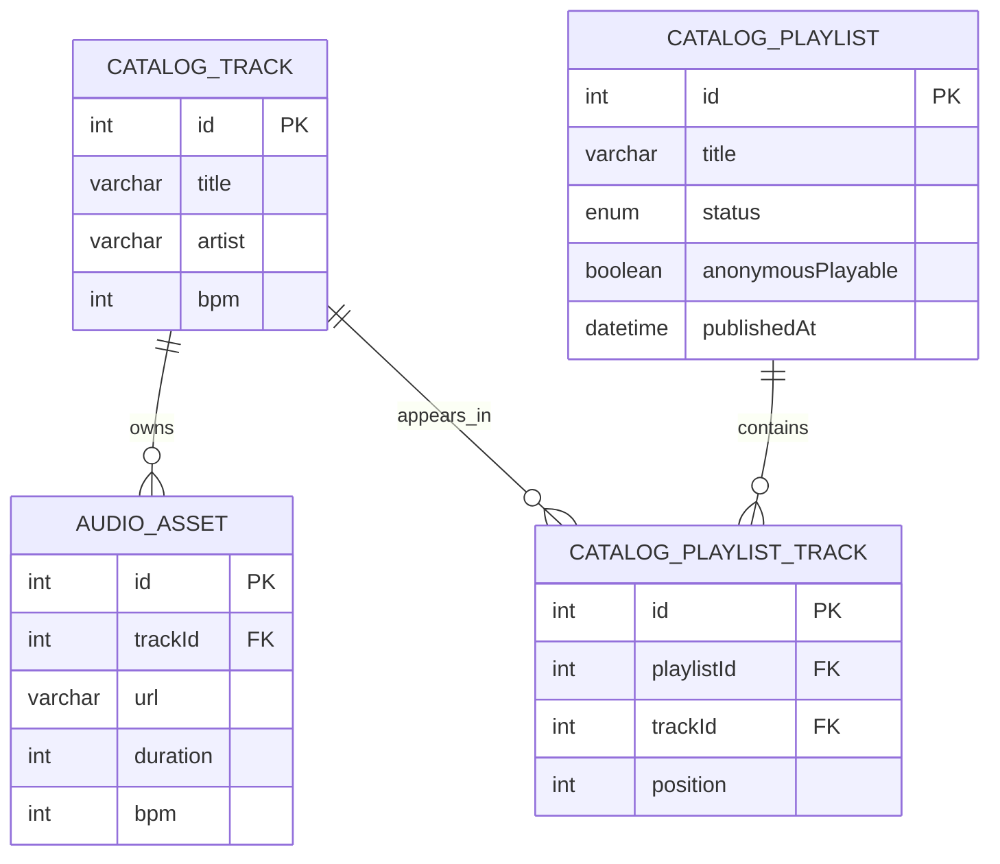
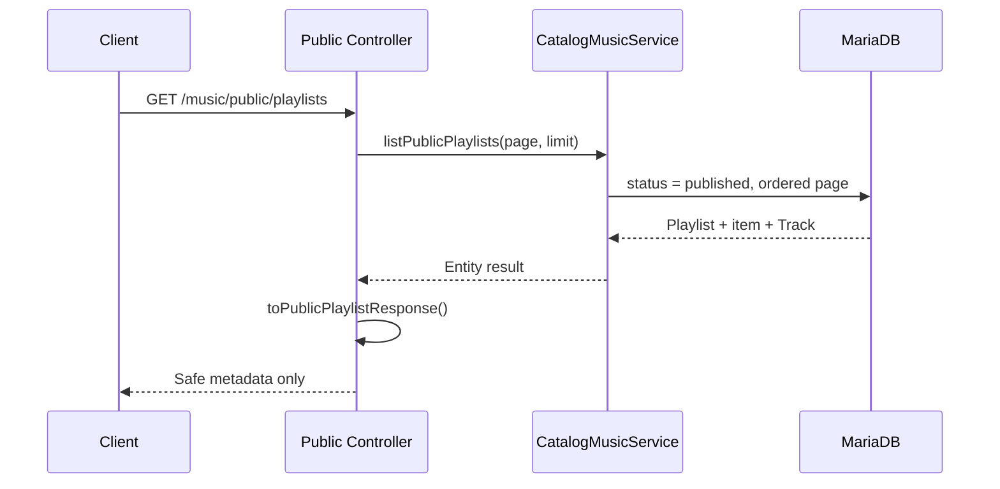

# Music 설계 및 아키텍처

> 검토 기준일: 2026-11-13 · 현재 구현과 확정된 목표 정책을 구분

## 1. 현재 아키텍처

Catalog와 Legacy는 현재 같은 도메인 이름을 사용하지만 물리적으로 분리되어 있습니다.

## 2. 데이터 모델

`playlist_track`는 `(playlistId, position)` unique index를 갖습니다. Playlist 안에서 순서가 하나만 존재해야 하기 때문입니다. Playlist 삭제는 관계 행을 cascade 삭제하고, Catalog Track 삭제는 Playlist 관계를 보호하도록 `RESTRICT`를 사용합니다.

## 3. API 경계

| API | 인증 | 목적 | 공개 응답 |
| --- | --- | --- | --- |
| `GET /music/public/playlists` | 없음 | published Playlist 목록 | 메타데이터와 Track 수 |
| `GET /music/public/playlists/:id` | 없음 | published Playlist 상세 | Track 요약과 position |
| `GET /music/tracks` | 없음 | Catalog Track 목록 | 제목, artist, BPM |
| `GET /music/tracks/:id` | 없음 | Catalog Track 상세 | 음원 URL 제외 |
| `POST /music/playlists` | JWT | Playlist 생성 | 관리 응답 |
| `PATCH /music/playlists/:id/publish` | JWT | 공개 전환 | 관리 응답 |
| `POST /music/playlists/:playlistId/tracks` | JWT | Track 추가 | 관계 응답 |
| `PATCH /music/playlists/:playlistId/tracks/reorder` | JWT | 전체 순서 변경 | 정렬된 관계 목록 |
| `/music/legacy/*` | JWT 또는 기존 route 정책 | 호환용 Legacy API | Legacy 계약 |

`anonymousPlayable`에는 공개 Playlist의 음원 접근 정책을 연결하기로 결정했습니다. 다만 현재는 playback API나 presigned URL 발급 기능이 없어, 이 값이 실제 재생 권한을 제어하지는 않습니다.

## 4. 공개 조회 흐름

공개 응답은 Entity를 직접 반환하지 않고 presenter를 통과합니다. 이 경계가 `url`, object key, 내부 timestamp 같은 값을 제외하는 위치입니다.

## 5. 관리 명령 흐름

Track·AudioAsset·Playlist의 생성, 수정, 삭제, publish, Track 추가, reorder는 `@AdminOnly()`(JWT + `role = admin`)로 보호합니다. 일반 사용자 토큰이면 403입니다.

- 역할은 `JwtStrategy`가 매 요청 DB에서 다시 읽으므로 변경이 즉시 반영됩니다.
- 사용자별 소유권(`ownerId`)은 없습니다. 카탈로그는 운영자가 관리하는 전역 데이터입니다.
- 쓰기 라우트에 `@AdminOnly()`가 빠지면 `src/music/music-authorization.spec.ts`가 실패합니다.

reorder는 다음 원칙을 사용합니다.

1. 요청에는 Playlist의 모든 item이 한 번씩 포함되어야 합니다.
2. item ID가 다른 Playlist 소속이면 거부합니다.
3. position 중복을 거부합니다.
4. 임시 음수 position을 저장한 뒤 최종 position을 저장합니다.
5. 작업은 transaction으로 묶습니다.

## 6. 설계상 현재 한계

- Catalog와 Legacy에 Track/Playlist 이름이 중복됩니다.
- Catalog Playlist 관리 기능은 아직 별도 application use case가 아니라 `CatalogMusicService`에 집중되어 있습니다.
- 권한은 user/admin 두 단계이며 사용자별 소유권이나 editor 역할은 없습니다. 현재 확정된 목표에도 개인·공유 Playlist는 포함되지 않습니다([결정 문서](decisions.md#2-사용자가-확정한-목표-정책-2026-11-13)).
- 재정렬은 기존 항목을 트랜잭션 밖에서 읽고, 항목 수 상한 없이 2N회 UPDATE합니다(감사 DB-8).
- AudioAsset은 URL 메타데이터 저장만 지원하며 S3 upload/delete lifecycle은 구현하지 않았습니다.
- Catalog의 현재 `position`은 단일 순서 값입니다. 관리 순서와 재생 순서를 분리하는 목표 정책은 아직 구현되지 않았습니다.
- 현재는 soft delete와 관리자 purge 흐름이 없습니다. 목표는 활성 Catalog 레코드를 soft delete하고 Legacy 테이블은 이관 후 불변 snapshot으로 보존하는 것입니다.
- 공개 Playlist 메타데이터와 익명 재생 허용 정책은 분리하기로 결정했지만, 실제 playback URL 발급 기능은 아직 없습니다.
- 공개 Playlist pagination은 지원하지만 날짜 검색, title 검색, 전체 duration 합계는 아직 응답 계약에 없습니다.

## 7. 확정된 목표 정책과 구현 방향

1. Catalog를 유일한 Music 기준으로 사용합니다. Legacy 데이터를 이관·검증한 뒤 Legacy API를 종료하고, Legacy 테이블은 복구·감사 가능하도록 보존합니다.
2. 특정 날짜의 Playlist 수와 Playlist 내 동일 Track 수에는 제한을 두지 않습니다. 이에 대한 unique 제약을 추가하지 않습니다.
3. Playlist 관리/표시 순서와 실제 재생 순서를 별도 값으로 관리합니다. 활성 항목의 각 순서 고유성과 soft-deleted 항목의 인덱스 처리 방식을 함께 설계합니다.
4. 활성 Catalog 레코드(Playlist item 포함)는 soft delete합니다. 완전 삭제는 관리자만 수행하는 별도 purge 흐름으로 분리하고, Legacy 테이블은 이관 후 불변 snapshot으로 보존합니다.
5. Playlist는 `draft → published → archived`로 전이하고 archived는 draft로 복원할 수 있습니다. soft delete는 공개 상태와 별도로 관리합니다.
6. 공개 Playlist 메타데이터와 음원 재생을 분리합니다. `anonymousPlayable`에 따라 익명 재생을 제한하고, 저장 URL 대신 만료되는 서명 URL을 발급합니다.
7. 순서·삭제·공개 상태 변경을 application 계층의 명시적인 작업으로 처리하고, 공개/관리 응답 DTO와 OpenAPI 계약을 분리합니다.
