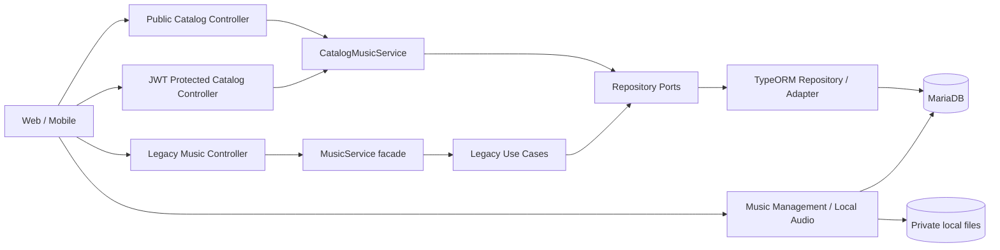
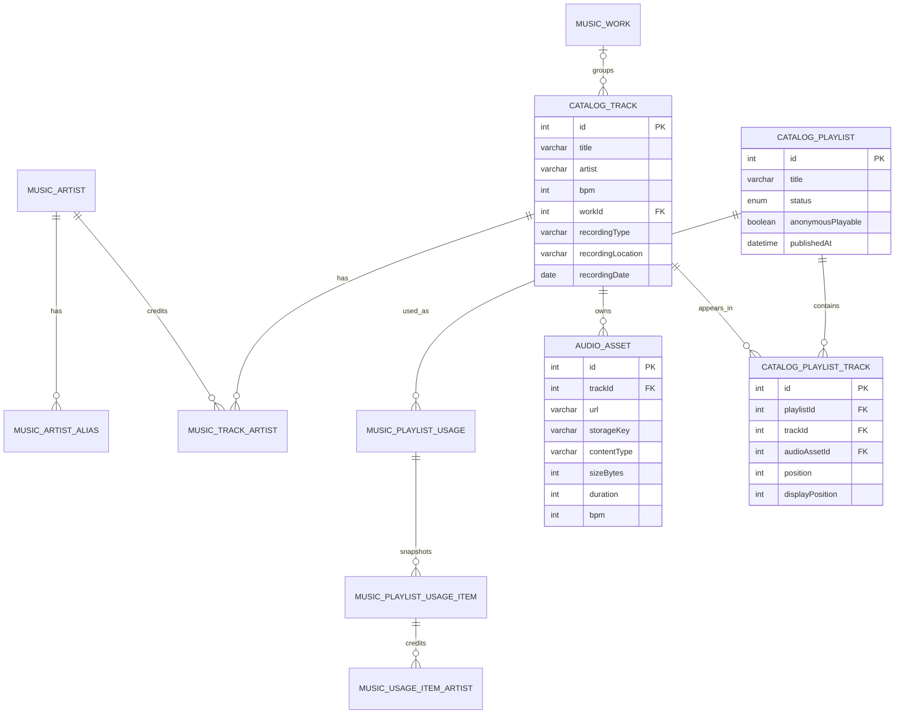
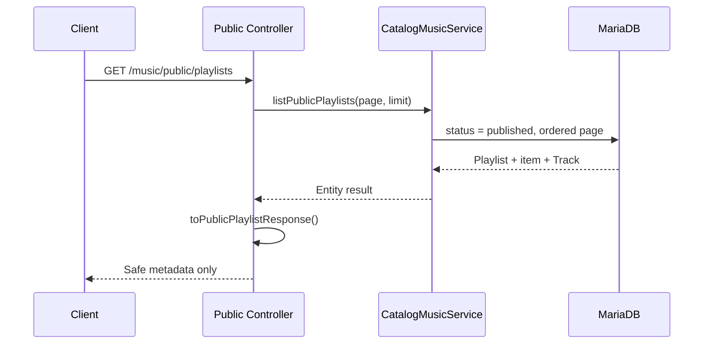

# Music 설계 및 아키텍처

> 검토 기준일: 2026-11-17 · 스테이징된 구현과 미완료 목표를 구분

## 1. 현재 아키텍처

Catalog와 Legacy는 현재 같은 도메인 이름을 사용하지만 물리적으로 분리되어 있습니다.

## 2. 데이터 모델

`playlist_track`는 `(playlistId, position)` unique index를 갖습니다. Playlist 안에서 순서가 하나만 존재해야 하기 때문입니다. Playlist 삭제는 관계 행을 cascade 삭제하고, Catalog Track 삭제는 Playlist 관계를 보호하도록 `RESTRICT`를 사용합니다.

## 3. API 경계

| API | 인증 | 목적 | 공개 응답 |
| --- | --- | --- | --- |
| `GET /music/public/playlists` | 없음 | published Playlist 목록 | 메타데이터와 Track 수 |
| `GET /music/public/playlists/:id` | 없음 | published Playlist 상세 | Track 요약과 position |
| `GET /music/tracks` | 없음 | Catalog Track 목록 | 제목, artist, BPM |
| `GET /music/tracks/:id` | 없음 | Catalog Track 상세 | 음원 URL 제외 |
| `POST /music/playlists` | admin | Playlist 생성 | 관리 응답 |
| `PATCH /music/playlists/:id/publish` | admin | 공개 전환 | 관리 응답 |
| `POST /music/playlists/:playlistId/tracks` | admin | Track 추가 | 관계 응답 |
| `PATCH /music/playlists/:playlistId/tracks/reorder` | admin | 전체 순서 변경 | 정렬된 관계 목록 |
| `/music/management/*` | admin | 아티스트·작품·사용 회차·통계 관리 | 관리 응답 |
| 재생 content 경로 | public / JWT / admin | 공개 정책 및 역할에 따라 선택 파일 전달 | 바이너리 Range 지원 |
| `/music/legacy/*` | JWT 또는 기존 route 정책 | 호환용 Legacy API | Legacy 계약 |

`anonymousPlayable=true`인 공개 Playlist의 선택 파일만 익명 경로에서 재생됩니다. 인증 경로도 공개 Playlist만 허용합니다. 로컬 파일은 서버가 직접 전달하며 presigned URL은 미구현입니다.

## 4. 공개 조회 흐름

공개 응답은 Entity를 직접 반환하지 않고 presenter를 통과합니다. 이 경계가 `url`, object key, 내부 timestamp 같은 값을 제외하는 위치입니다.

## 5. 관리 명령 흐름

Track·AudioAsset·Playlist의 생성, 수정, 삭제, publish, Track 추가, reorder는 `@AdminOnly()`(JWT + `role = admin`)로 보호합니다. 일반 사용자 토큰이면 403입니다.

- 역할은 `JwtStrategy`가 매 요청 DB에서 다시 읽으므로 변경이 즉시 반영됩니다.
- 사용자별 소유권(`ownerId`)은 없습니다. 카탈로그는 운영자가 관리하는 전역 데이터입니다.
- `src/music/music-authorization.spec.ts`는 기존 Catalog·Legacy 컨트롤러의 쓰기 권한을 검사합니다. 새 관리·업로드 컨트롤러의 권한 검사는 별도로 보강해야 합니다.

reorder는 다음 원칙을 사용합니다.

1. 요청에는 Playlist의 모든 item이 한 번씩 포함되어야 합니다.
2. item ID가 다른 Playlist 소속이면 거부합니다.
3. position 중복을 거부합니다.
4. 추가와 재정렬은 transaction에서 Playlist 행을 `pessimistic_write`로 잠가 같은 Playlist의 편집을 직렬화합니다.
5. 재정렬은 잠금을 얻은 뒤 현재 항목 전체를 읽고 요청 항목과 대조합니다. 잠금 대기 중 항목이 추가되면 오래된 재정렬 요청을 거부해 변경을 보존합니다.
6. 임시 음수 position을 저장한 뒤 최종 position을 저장합니다.
7. 작업은 transaction으로 묶습니다.

## 6. 설계상 현재 한계

- Catalog와 Legacy에 Track/Playlist 이름이 중복됩니다.
- Catalog Playlist 관리 기능은 아직 별도 application use case가 아니라 `CatalogMusicService`에 집중되어 있습니다.
- 권한은 user/admin 두 단계이며 사용자별 소유권이나 editor 역할은 없습니다. 현재 확정된 목표에도 개인·공유 Playlist는 포함되지 않습니다([결정 문서](decisions.md#2-사용자가-확정한-목표-정책-2026-11-13)).
- 재정렬은 Playlist 잠금과 transaction 안에서 현재 항목을 확인합니다. 다만 항목 수 상한은 없고 2N회 UPDATE하므로 대량 재정렬 비용은 남은 최적화 항목입니다.
- AudioAsset은 URL 메타데이터와 로컬 파일 업로드를 지원합니다. S3와 로컬 파일 삭제·복구 lifecycle은 구현하지 않았습니다.
- `displayPosition`이 저장되지만 독립 편집과 정렬은 아직 구현되지 않았습니다. 현재 정렬은 `position`을 사용합니다.
- 현재는 soft delete와 관리자 purge 흐름이 없습니다. Legacy 이관·검증과 테이블 제거도 미구현입니다.
- 재생은 로컬 파일 직접 전달이며 S3, 만료 URL, 파일 저장소 교체·삭제 lifecycle은 미구현입니다.
- 공개 Playlist pagination은 지원하지만 날짜 검색, title 검색, 전체 duration 합계는 아직 응답 계약에 없습니다.

## 7. 확정된 목표 정책과 구현 방향

1. Catalog를 유일한 Music 기준으로 사용합니다. 백업과 Legacy 이관·검증 후 Legacy API·코드와 테이블을 정리합니다.
2. 특정 날짜의 Playlist 수와 Playlist 내 동일 Track 수에는 제한을 두지 않습니다. 이에 대한 unique 제약을 추가하지 않습니다.
3. Playlist 관리/표시 순서와 실제 재생 순서를 별도 값으로 관리합니다. 활성 항목의 각 순서 고유성과 soft-deleted 항목의 인덱스 처리 방식을 함께 설계합니다.
4. 활성 Catalog 레코드(Playlist item 포함)는 soft delete하고 완전 삭제는 관리자만 수행하는 별도 purge 흐름으로 분리합니다.
5. Playlist는 `draft → published → archived`로 전이하고 archived는 draft로 복원할 수 있습니다. soft delete는 공개 상태와 별도로 관리합니다.
6. 공개 Playlist 메타데이터와 음원 재생을 분리합니다. 현재 `anonymousPlayable`에 따라 로컬 파일 접근을 제한하며 S3 및 서명 URL은 추후 작업입니다.
7. 순서·삭제·공개 상태 변경을 application 계층의 명시적인 작업으로 처리하고, 공개/관리 응답 DTO와 OpenAPI 계약을 분리합니다.
